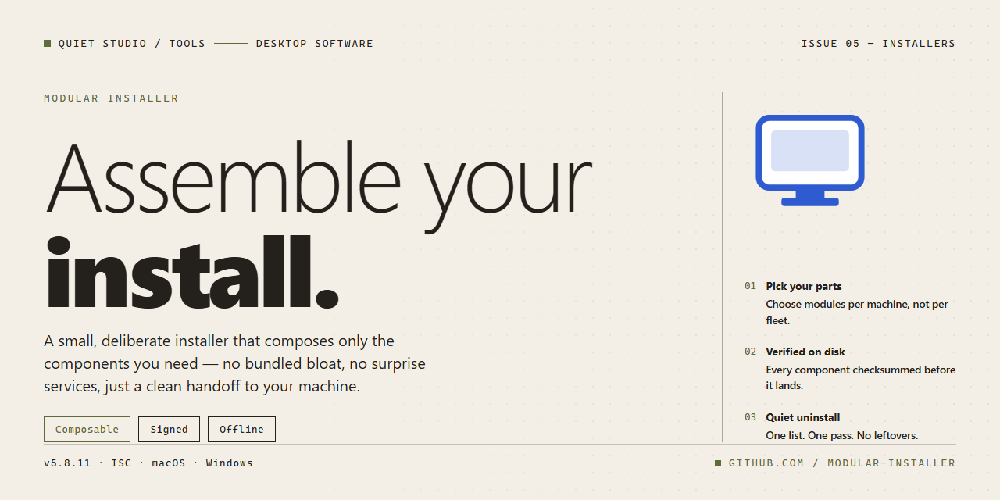

# Modular App Installer & Updater with Live Logs for Windows 11

### 🚀 PowerShell Quick Install

  

---

Modular Installer is a Windows desktop utility that consolidates application deployment and system maintenance into a single, self-contained executable. Users select from a curated catalog of software packages, and the tool installs each selection while streaming live logs to the interface, keeping every operation transparent and observable. Beyond installation, it updates both managed applications and Windows itself, handling elevation, job sequencing, and cancellation through a responsive background worker. The entire toolchain builds to a standalone double-click executable, so no separate runtime setup or command-line invocation is required.

## ✅ Before You Start

- **PowerShell 5.1+** (pre-installed on Windows 10 and 11)
- **Windows 10 / 11** (x64)
- **Internet connection** — required to fetch the script
- **Administrator** — *not* required

## Features

**Selectable application catalog:** Applications are grouped by category and presented with checkboxes, letting you assemble an install set before any action begins. Default selections are driven by a per-entry flag, so a curated baseline can be predefined while optional items remain opt-in.

- **Live streamed logs:** Installer output is captured from stdout and stderr concurrently, line by line, and streamed into the interface as it is produced. Spinner characters and block-style progress bars are filtered out so the log stays readable.

- **Direct process execution:** Each action starts its target program directly by full path rather than through a shell, so no command interpreter parses arguments and application names never appear on a command line.

- **Responsive during long operations:** Work runs on a separate runspace and results reach the interface through a thread-safe queue drained by a UI timer. Per-tick processing is budgeted and the pending backlog is capped, so a program that emits tens of thousands of lines cannot freeze the window.

- **App upgrades and system updates:** Dedicated actions upgrade installed applications in bulk and drive Windows Update, each executed as an isolated job within the same streamed log view.

- **Job-based execution model:** Every action — app install, app upgrade, system update — is a small job object, and the worker processes a list of jobs sequentially. Cancellation skips the remaining tasks after the current one completes; a separate force-stop option terminates the running task after confirmation.

- **Safe shutdown behavior:** Closing the window during an active install prompts first, then stops the running task and everything it spawned.

- **Single-instance enforcement:** A second copy refuses to start, preventing concurrent runs from contending over the Windows Installer lock.

- **Validated catalog at startup:** The application table is checked when the program launches; missing fields, empty or duplicate identifiers, and malformed selection flags produce a message listing every problem instead of starting.

- **Simulation mode:** A dry-run switch simulates package operations and system updates with synthetic output, so the interface and workflow can be exercised without installing anything.

- **Self-contained executable build:** The tool compiles to a standalone double-click executable of roughly 50 KB with the script embedded inside, so it runs without the source file beside it. The build uses the C# compiler included with Windows and downloads nothing.

- **Elevated manifest and silent launch:** The built executable requests Administrator rights through its manifest, so Windows shows the elevation prompt on launch, and no console window appears — only the installer interface.

- **Build-time safeguards:** The build step refuses to embed a script containing syntax errors or non-ASCII characters, treats compiler warnings as errors, and writes a checksum file alongside the executable. A test build option produces a variant that does not prompt for elevation.

- **Deterministic code paths:** Elevated operations are launched from fixed system locations rather than resolved through the PATH at run time, and elevated module loading is restricted to administrator-writable directories with signature verification before import.

## How it works

Modular Installer is built around a single job model that drives every operation the application performs. Each install, app upgrade, or system update is represented as an individual job object, and the worker processes a queued list of these jobs on a dedicated runspace. Because the runspace is separate from the interface thread, the window remains fully responsive while installers execute in the background.

The worker launches each job's underlying program directly by its full path rather than routing through a command shell, eliminating shell parsing from the execution path. Standard output and standard error are read concurrently, line by line, so long-running installers stream progress continuously instead of buffering until completion.

Captured lines are pushed onto a thread-safe queue. A dispatcher timer on the interface thread drains that queue into the live log view on each tick, which means the worker never touches UI elements directly. Cosmetic noise such as spinner characters and block-style progress bars is filtered out before display, keeping the log readable.

Exit codes are interpreted rather than treated uniformly. Statuses indicating an application is already installed or already current are counted as success, while integrity failures such as hash mismatches surface with a plain-language explanation instead of a raw error code.

Cancellation is handled in two stages. A standard cancel request lets the current task finish before skipping the remaining jobs, and never terminates an installer on its own. A second, confirmed action force-stops the active task. Closing the window mid-install prompts for confirmation, then stops the running task and any child processes it spawned.

The application enforces a single running instance, since concurrent installers would contend for the Windows Installer lock. To stay stable under heavy output, each timer tick operates within a fixed time budget and caps the pending backlog, so a program emitting tens of thousands of lines cannot freeze the interface; excessively long lines are truncated.

Building the standalone executable embeds the script at build time, so the resulting file runs without any supporting script alongside it. The build step rejects scripts containing syntax errors or non-ASCII characters, treats compiler warnings as errors, and emits a checksum file next to the executable. Because the embedded script is fixed at build time, any change to the application catalog requires a rebuild.

## Compatibility

Modular Installer targets Windows desktop environments with the Windows Package Manager available. The application has been validated across the following configurations.

**Operating System**

- Windows 11 (all editions) — primary target, fully supported.
- Windows 10 version 1809 or later — supported, provided the App Installer package is present and current.
- Windows Server and — supported when the Windows Package Manager is installed and the desktop experience is enabled.

**Windows Package Manager**

- winget version 1.4 or newer is recommended. Earlier versions may work, but features such as `-include-unknown` during bulk upgrades require a current release.
- The App Installer package must be installed and registered for the invoking user. Modular Installer invokes winget through its per-user alias path and does not search the system `PATH`.
- App source agreements must be acceptable on the host; the tool passes the acceptance flags explicitly so unattended runs do not stall.

**Runtime and Permissions**

- PowerShell 5.1 (built into Windows 10 and 11) is required for the compiled `.exe`. PowerShell 7 is supported when running the script directly.
- Administrator rights are required for installation and update operations. The executable requests elevation through its manifest; the script re-launches itself with a UAC prompt when needed.
- The GUI requires a desktop session with WPF support. Server Core installations without the desktop experience are not supported.

**Build Environment**

- The double-click `.exe` builds on any Windows 10 or 11 host using the C# compiler shipped with the operating system. No external toolchain, SDK, or network access is required to produce the binary.
- The resulting executable embeds the installer script, so the `.ps1` file does not need to accompany it at run time.

**Known Compatibility Notes**

- The executable is unsigned. Windows SmartScreen may present an "unknown publisher" prompt on first launch, and some endpoint protection products may flag unsigned custom executables. Building from source produces an equivalent binary with the same behavior.
- winget is an app-execution alias and cannot be signature-verified by the host; Modular Installer trusts it solely by its fixed per-user location.
- Windows Update operations depend on the PSWindowsUpdate module being present under `Program Files` with a valid Authenticode signature from its author. Hosts that block or remove the module will see the Windows Update job fail with a clear error before any import occurs.
- Environments that restrict `winget` by policy (for example, through AppLocker or WDAC) will prevent package operations; the tool surfaces the underlying error in the streamed log rather than retrying.
- Locale and codepage differences do not affect the build, which refuses non-ASCII content in the embedded script; ANSI-only systems are therefore fully supported.
- Running the plain script from a directory writable by non-administrators weakens the elevation boundary. The compiled executable is the recommended distribution form on shared or multi-user machines.

## FAQ

**Q: Does Modular Installer require winget, and what happens if it is missing?**
Yes. Package installation and application upgrades are delegated to winget, which ships with the App Installer package on Windows 10/11. If winget is absent or inaccessible, the affected jobs terminate with an explicit error in the log stream rather than falling back to an alternate install path. Windows Update jobs use a separate elevated child process and are unaffected by winget's presence.

**Q: How does the live log streaming stay responsive during long installs?**
Each action is modeled as a discrete job object executed on a background runspace. The worker launches each job's program directly—no shell interpreter—and reads stdout and stderr concurrently, line by line. Lines are enqueued on a thread-safe queue and drained into the log by a dispatcher timer on the UI thread, so the worker never touches UI state. Spinner glyphs and block progress bars are filtered out, per-tick work is bounded, and the pending backlog is capped so high-volume output cannot stall the window.

**Q: What exactly happens when I press Cancel versus Stop now?**
Cancel is cooperative: it lets the currently running task finish, then skips all remaining queued tasks. Stop now requires a confirmation and force-terminates the running task along with anything it spawned. Closing the window mid-install prompts first, then performs the same forced stop. Cancellation never kills an installer silently on the first click.

**Q: Can I preview the workflow without installing or updating anything?**
Yes. The dry-run mode simulates winget and Windows Update with synthetic output and skips the elevation requirement, so the full GUI and log pipeline can be exercised safely. Apps whose identifiers carry the designated failure suffix simulate a failed install, which is useful for validating error handling and log rendering.

**Q: How is the app catalog defined, and when is it validated?**
The catalog is a table of entries, each with a category, display name, exact package identifier, and a pre-checked flag. Categories group the list in order of first appearance. The entire table is validated at startup: identifiers are restricted to a safe character set and may not begin with a hyphen, and a missing field, empty or duplicate identifier, or non-boolean flag produces a single message enumerating every problem instead of launching. Because identifiers are matched exactly, they must be spelled precisely as the package source reports them.

**Q: How is the standalone executable produced, and does building it require downloads?**
The build script embeds the installer script inside a small executable using the C# compiler that ships with Windows—nothing is fetched or installed to build it. The resulting binary carries a manifest requesting administrator rights and launches without a console window. The build refuses to embed a script containing syntax errors or non-ASCII characters, treats compiler warnings as errors, and emits a checksum file alongside the output. Since the script is embedded at build time, the executable must be rebuilt after any catalog or logic change.

**Q: Why might SmartScreen or antivirus flag the executable?**
The binary is unsigned, so Windows may report an unknown publisher on first launch and some security products are cautious about unsigned custom executables. Building the executable yourself from the provided sources is the recommended safeguard. Note also that the plain script, when run from a directory writable by non-administrators, could be altered before an elevated run; the built executable avoids that exposure by embedding the script.

**Q: What are the elevation and process-launch guarantees?**
Programs are always started by full path—the package manager from its fixed per-user alias location, and system utilities from the system directory—never resolved through the PATH at run time. No shell interpreter participates in the real install path, and app names are never placed on a command line. The elevated Windows Update child loads its module only from a location writable exclusively by administrators, and every code file must carry a valid signature from the module author; a tampered, unsigned, or unexpected file halts the job with a clear error before anything is imported.

**Q: Why does a second instance refuse to start?**
Two concurrent installers would contend for the Windows Installer lock, producing opaque failures and interleaved state. The single-instance guard rejects the second copy outright.

**Q: An install failed with a hash mismatch—what does that mean?**
The publisher replaced the downloadable file after the package manifest was written, which occurs with unversioned download locations, particularly shortly after a release. The package manager blocks this deliberately. Retrying once the manifest is refreshed typically resolves it.

**Q: What are the known limitations I should plan around?**
The executable is unsigned; the package manager is an app-execution alias and cannot be signature-verified, so it is trusted by fixed location only; stdout and stderr are separate pipes, so their relative ordering in the log is best-effort; and the bulk-upgrade operation updates every package the manager can identify—including those with unknown installed versions—which may upgrade software you intentionally left unchanged.

## Disclaimer

Modular Installer is provided as a free, open tool for selecting, installing, and updating applications and Windows components on supported systems. It is supplied "as is" and without warranty of any kind, express or implied, including but not limited to the implied warranties of merchantability, fitness for a particular purpose, and non-infringement.

Use of this software is entirely at your own risk. The authors and contributors accept no liability for any direct, indirect, incidental, special, consequential, or punitive damages arising from the use of, or inability to use, this software — including but not limited to data loss, system instability, failed or partial installations, unintended application upgrades, or interruption of an in-progress installation.

The tool orchestrates third-party package managers, installers, and update mechanisms. It does not control, audit, or guarantee the content, licensing, behavior, or integrity of the software it installs or updates. Those components are governed by their own terms, and any issues with them fall outside the scope of this project. Package identifiers are matched exactly, but catalog accuracy and package availability depend on the underlying sources and may change without notice.

Certain features operate with elevated privileges and modify system state. Cancellation and forced-stop actions are provided for convenience but do not guarantee rollback of changes already applied; stopping an operation mid-install may leave a system in an inconsistent state. Users are responsible for maintaining backups and for reviewing selections before confirming any operation.

The executable produced by the build process is unsigned. Operating system and security software may warn about running unsigned binaries; building from source is provided as the recommended safeguard. No guarantee is made regarding compatibility with any specific configuration, third-party modification, or future platform version.

By downloading, building, or running Modular Installer, you acknowledge that you have read and understood this disclaimer and agree to assume full responsibility for any outcomes resulting from its use.

## License

Modular Installer is released under the MIT License. The license grants permission to use, copy, modify, merge, publish, distribute, sublicense, and sell copies of the software and its documentation, subject to inclusion of the copyright notice and this permission notice in all copies or substantial portions of the software.

The software is provided "as is", without warranty of any kind, express or implied, including but not limited to the warranties of merchantability, fitness for a particular purpose, and noninfringement. In no event shall the authors or copyright holders be liable for any claim, damages, or other liability, whether in an action of contract, tort, or otherwise, arising from, out of, or in connection with the software or the use or other dealings in the software.

Because Modular Installer builds to a standalone executable and executes elevated operations on the host system, downstream distributors who modify or repackage the source are responsible for ensuring that any embedded script, build artifact, or bundled catalog they ship complies with the terms above. The license places no restriction on commercial or internal deployment, and no attribution beyond the preserved copyright and permission notice is required.